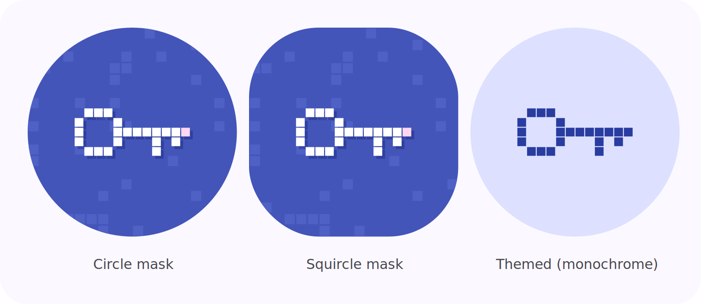

<p align="center">
  
</p>

<p align="center">
  <a href="https://github.com/Abdogouhmad/keyel/releases/latest"></a>
  <a href="https://github.com/Abdogouhmad/keyel/releases"></a>
  
  <a href="LICENSE"></a>
  
  
</p>

<h3 align="center">Your passwords, sealed on your device — and nowhere else.</h3>

<p align="center">
  <strong>Keyel</strong> (<em>key</em> + <em>-el</em>, as in pixel / voxel) is an <strong>offline-first, privacy-first password manager</strong>
  for Android, Windows, macOS and Linux.<br>
  No account. No server. No telemetry. Just a Rust-hardened vault that only you can open.
</p>

---

## Why Keyel

- **Offline by design.** Your vault is a single encrypted file in the app's private
  storage. There is no cloud sync and no account to breach — nothing to leak because
  nothing is ever sent. The *only* network access is the update check you opt into.
- **Rust all the way down.** Every secret is encrypted and stored by a pure-Rust core
  (`crates/keyel_core`) — Argon2id key derivation and authenticated encryption — with
  secrets zeroized in memory. Dart only ever sees what you explicitly reveal.
- **Yours to audit.** The crypto core, the vault format and the release pipeline are
  all open source. The vault format is frozen behind a byte-exact test fixture, so a
  change that could strand an existing vault fails CI before it ships.
- **Everywhere you are.** One adaptive Material 3 UI for phone, foldable, tablet and
  desktop, shipped as native installers for all four platforms.

## Features

**Vault & security**

- Encrypted `vault.keyel` — Argon2id-derived key + authenticated encryption.
- Unlock with a master password, plus optional **biometric** quick unlock.
- A **recovery key** that can reset a forgotten master password (and no backdoor
  without it).
- **Security dashboard** — vault health score with weak, reused, old and
  insecure-URL findings, plus missing-2FA detection.
- **Auto-lock** when the app leaves the foreground, and automatic **clipboard
  clearing** of copied secrets.

**Everyday use**

- **Entries** — logins, payment cards and secure notes, with folders, favourites,
  fast search and a soft-delete **trash**.
- **Password generator** — passwords and passphrases with configurable rules and a
  live strength meter.
- **TOTP (2FA)** — store and display time-based one-time codes.
- **Custom entry icons** — a searchable catalog that suggests icons from the title
  or URL.
- **Android autofill** — fill credentials straight into apps and browsers.

**Import, export & updates**

- Import from **Bitwarden** and generic **CSV**; encrypted **backup & restore**;
  plain CSV export (unencrypted — for migration only).
- **Over-the-air updates** on Android, verified by SHA-256 before install.

## Install

Grab the latest build from **[Releases](https://github.com/Abdogouhmad/keyel/releases/latest)**:

| Platform | Download | Notes |
|---|---|---|
| **Android** | `keyel-v<version>-universal.apk` | One APK for every device. `arm64-v8a` / `armeabi-v7a` splits are also published. |
| **Windows** | `keyel-v<version>-windows-x64-setup.exe` | Double-click installer (per-user, no admin prompt). A portable `.zip` is also published. |
| **macOS** | `keyel-v<version>-macos-universal.dmg` | Universal (Apple Silicon + Intel). Open the `.dmg` and drag **Keyel** to *Applications*. |
| **Linux** | `keyel-v<version>-linux-x64.AppImage` | Single runnable file: `chmod +x` it and double-click (needs FUSE2), or run `./keyel-v<version>-linux-x64.AppImage --appimage-extract-and-run`. A portable `.tar.gz` is also published. |

Every release also ships `checksums.txt`. Verify before you run:

```bash
sha256sum -c checksums.txt          # Linux
shasum -a 256 -c checksums.txt      # macOS
```

> **macOS first launch:** the app is ad-hoc signed (no paid Developer ID), so Gatekeeper
> warns once — right-click **Keyel → Open**, or allow it in *System Settings → Privacy &
> Security*.

### Release channels

Android updates are checked against one of two manifests:

| Channel | Manifest | How it is published |
|---|---|---|
| **Stable** | [`update_manifest.json`](update_manifest.json) | Automatically when a version bump lands on `main` (`pubspec.yaml` + `CHANGELOG.md`). |
| **Beta** | [`update_manifest_beta.json`](update_manifest_beta.json) | Manually, by dispatching the `release` workflow with `channel=beta` and a `beta_version` (and optional `beta_notes`). |

Beta builds are **GitHub prereleases** with their own manifest, so opting into one never
changes what stable users are offered. A beta does **not** touch `pubspec.yaml` or
`CHANGELOG.md` and is **never** published automatically on a push — someone must start the
workflow. Both channels sign and verify their APKs the same way, and every downloaded APK
is SHA-256-checked before install. The beta manifest starts empty (no beta published yet);
the updater simply finds no candidate until the first beta dispatch.

## Security at a glance

- The release APK requests `INTERNET` for the update checker/downloader and, **only after
  you opt in** in *Security Health*, the HIBP breach-check range request. Both are HTTPS;
  no vault data, username or password is uploaded — the breach check sends only the first
  5 characters of a locally computed SHA-1 hash. Automatic update checks (on by default,
  toggleable in *Software Update*) read only the public channel manifest when the app opens
  and while it is in the foreground — there is no background service. Downloaded APKs are
  SHA-256-verified before the system installer runs.
- On Android 13+ the app requests `POST_NOTIFICATIONS` so an update can raise an OS
  notification alongside the in-app banner. It is opt-in, shown once, and can be revoked in
  Android settings; no other notifications are sent.
- `allowBackup=false`; cloud and device backups exclude the vault file.
- Secrets live in Rust (`zeroize` / `secrecy`); Dart receives only user-revealed values.
- *Settings → Report a problem* shares a redacted diagnostics file (version, device, OS,
  non-secret settings) — never vault contents, titles, passwords or key material.

Read the full model in [`docs/crypto-design.md`](docs/crypto-design.md),
[`docs/threat-model.md`](docs/threat-model.md) and [`docs/vault-model.md`](docs/vault-model.md).

## FAQ

**What if I forget my master password?**
Choose *Use recovery key* on the unlock screen and enter the key you saved at setup, then
set a new password. If you have lost **both**, the vault cannot be recovered — there is no
server, no backdoor and no reset. Restore from an encrypted backup instead.

**Does Keyel send my data anywhere?**
Not your vault. The only network access is the optional update check and download. No
vault contents, titles, passwords or key material are ever transmitted.

**Where is my data stored?**
In one encrypted `vault.keyel` file in the app's private storage. The decryption key
exists only in memory, and only while the vault is unlocked.

**Is the CSV export encrypted?**
No — it is plain text. Use *Encrypted backup* for anything you intend to keep.

## Backups

- Use *Settings → Backup & import → Encrypted backup*; its password is independent of
  your master password.
- Keep at least one copy **offline and separate** from the device, and **test a restore**
  before you rely on it.
- Store the recovery key offline too — it is a second, independent way in.
- Never keep the plain CSV export on a shared or cloud drive.

## Build from source

### Prerequisites

- Flutter (stable) + Dart
- Rust stable (rustup) with Android targets:
  ```bash
  rustup target add aarch64-linux-android armv7-linux-androideabi x86_64-linux-android i686-linux-android
  ```
- Android SDK (API 36) + NDK, and a device or emulator.
- `flutter_rust_bridge_codegen` (v2) and `cargo-ndk`:
  ```bash
  cargo install flutter_rust_bridge_codegen cargo-ndk
  ```

For a desktop build you also need the host toolchain: Visual Studio (Desktop development
with C++) on Windows, Xcode on macOS, or the usual GTK/CMake stack on Linux. The Rust core
is compiled by cargokit for each host, so no extra Rust targets are needed.

### Run

```bash
flutter devices              # pick your device/emulator
flutter run                  # debug build; builds Rust via cargokit automatically
flutter run -d linux         # or -d windows / -d macos
```

The first Rust build takes a few minutes (FRB codegen + NDK toolchain). The desktop window
opens at 1200×800 and will not shrink below a phone-sized minimum.

### Test

```bash
cargo test                          # Rust core (crypto, generator, ...)
cargo clippy --workspace --all-targets -- -D warnings
cargo fmt --check
flutter analyze
flutter test
```

### Fuzz the vault parser

```bash
cd crates/keyel_core
cargo +nightly fuzz run parse_vault -- -max_total_time=600
```

### Regenerate the bridge after editing `rust/src/api/**`

```bash
flutter_rust_bridge_codegen generate
```

## Project layout

See [`docs/plan.md §5`](docs/plan.md) for the full structure. Quick tour:

| Path | What |
|---|---|
| `crates/keyel_core/` | Pure Rust core: crypto, vault format, generator (fully tested, no UI deps) |
| `rust/` | FRB bridge crate — the *only* surface exposed to Dart |
| `lib/` | Flutter app (features, ui, data, core) |
| `packaging/` | Native installers (Inno Setup for Windows) |
| `tool/build_linux_appimage.sh` | Builds the Linux `.AppImage` from a Flutter release bundle |
| `docs/` | plan, design spec, crypto spec, threat model, roadmap, decision log |
| `design/` | App icon and Stitch UI screens |

## License

[GPL-3.0-or-later](LICENSE) — see [`LICENSE`](LICENSE).
